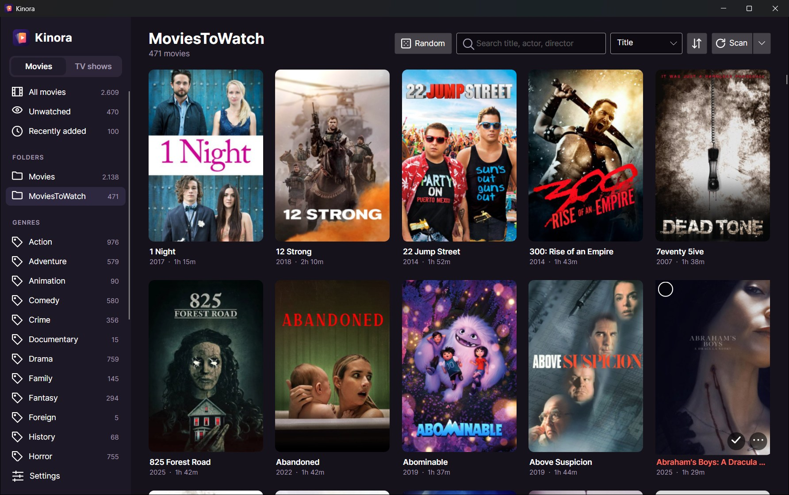
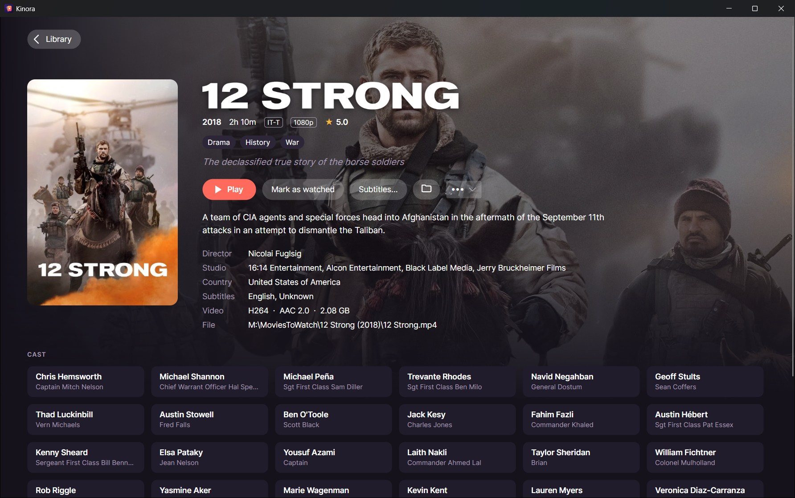
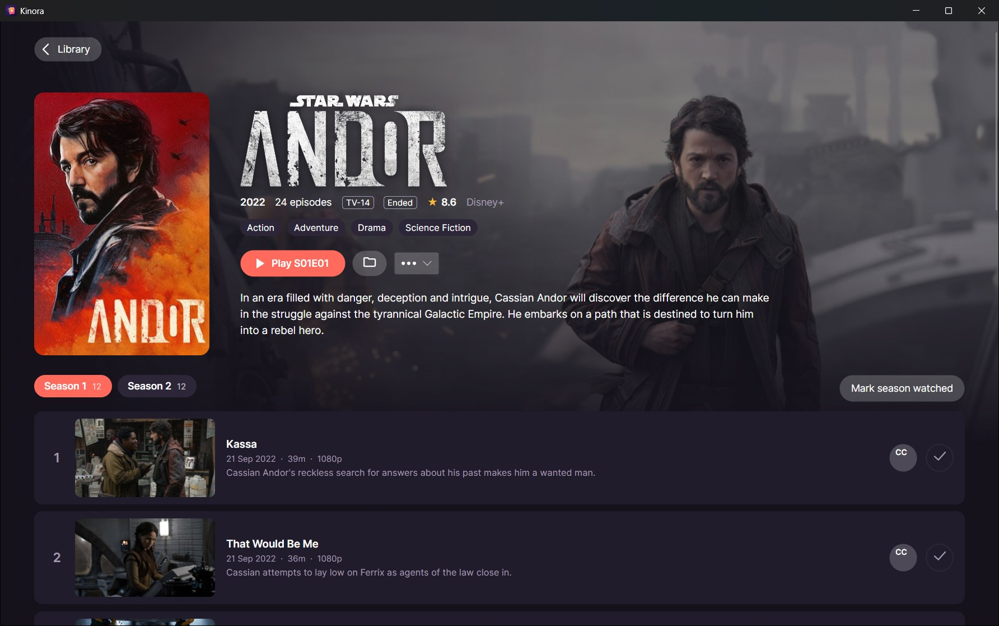
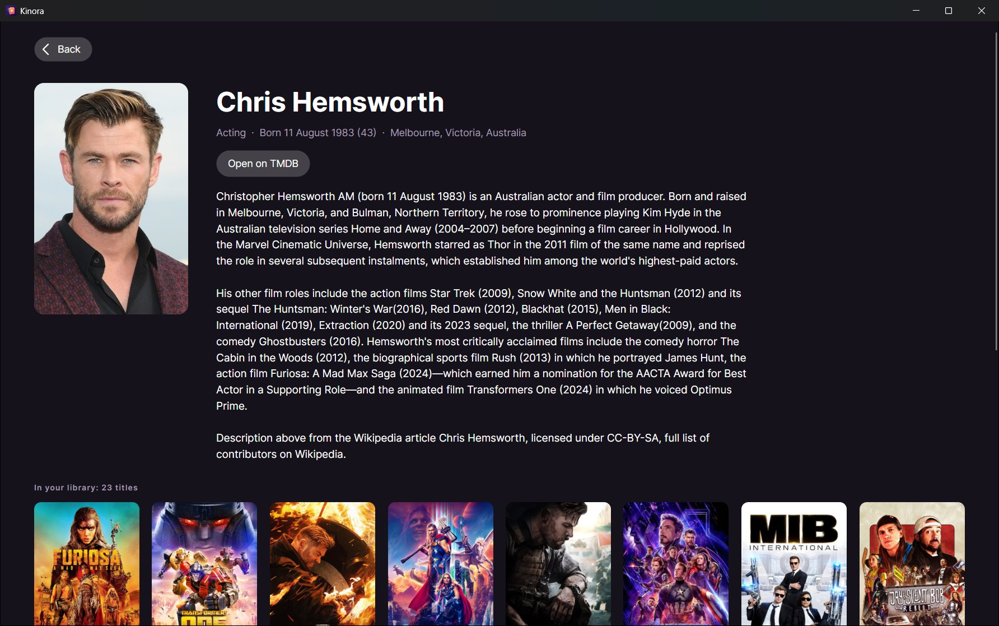
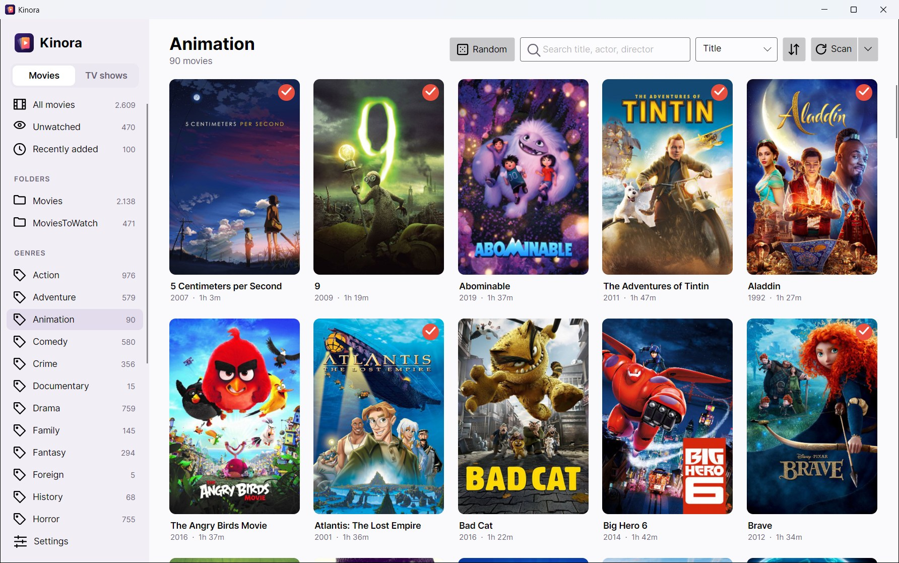

# Kinora

[](https://github.com/FirekeeperPhate/Kinora/releases/latest)
[](https://github.com/FirekeeperPhate/Kinora/releases)
[](LICENSE)

A desktop library for movies and TV shows kept in folders on a disk or a NAS.
Covers, metadata, light and dark theme; Play opens the video in Kinora's own player (VLC's
engine), or, if you prefer, in the player the OS associates with it. Windows, Linux and macOS
(Avalonia 12, .NET 10).

**[Download the latest release](https://github.com/FirekeeperPhate/Kinora/releases/latest)**



| | |
|---|---|
|  |  |
| A movie page: Play, watched, subtitles, the folder, Move to | A show: seasons, episodes, the next one to play |
|  |  |
| Click a name in the cast: biography and their titles in the library | Light theme |

<sub>Posters, pictures and texts in the screenshots come from TMDB and belong to their owners.</sub>

## What it does now

- **Library folders**: as many as you like. Each movie in its own folder, collection folders
  (`Alien Collection/Alien (1979)/…`), or loose files in the root.
- **Local metadata first**: Kodi / Emby / Jellyfin `.nfo` files (`movie.nfo` and `<video>.nfo`:
  the newer wins, the older fills the gaps), posters, fanart and clear logos with the usual names,
  subtitles next to the video. Without an nfo, title and year come from the folder or file name;
  `[imdbid-tt…]` and `{tmdb-…}` in names are read too.
- **Fast on a NAS**: the library opens from a local SQLite database and a local cache of resized
  posters, never touching the share. A scan enters only the folders whose time changed; a full
  scan reads them all. 472 movies on a NAS: first scan 8.5 s (posters included), the next 0.1 s.
- **Offline-safe**: a root that doesn't answer (NAS asleep or off) deletes nothing; its movies are
  marked offline.
- **Watched** flags survive rescans, and a movie moved outside Kinora keeps it (by IMDb/TMDB id).
- Search across title, original title, year, director, collection and cast; accents and
  punctuation don't matter. What is called just that comes first, then what begins with it, so "Her"
  isn't lost among "Others" and "Sherlock". Sort by title, year, date added, rating;
  by title "The Matrix" goes under M, or under T if you untick that in Settings → Library.
- **Filters** in the toolbar: resolution, HDR, decade, rating, collection (for shows decade and
  rating), and only unwatched, which works in any view (a genre, a folder) and stays on from one
  to the next. HDR comes from the nfo's
  `hdrtype` or the file name; for what is already in the library the nfo is read by a full scan.
- **Collections**, in the sidebar of the movies: every collection as a poster (one of its movies'), with
  how many movies it has and their years; the search finds a collection by its name or by one of its
  movies. A click shows its movies in the order they came out; Back, or Esc, returns to them all. The
  collection on a movie's page opens it here.
- **Duplicates**, in the sidebar when there are any: the same movie or show more than once, in the
  same folder or in two (an id in common, or the same name and year without ids), side by side
  with the size, the resolution and the folder of each copy.
- **Needs attention**, in the sidebar when there is something in it: titles without a poster or a
  plot, movies loose in the root, episode files without season and number, the same episode twice,
  and the folders where the last scan found no video (a click opens one).
- **Random** offers something not seen yet from the current view and its filters; **Another one** on
  its page doesn't come back to a title already offered until the others have all been.
- **History**, in the sidebar: what you watched and when, the last viewing first, with what this
  year and all of it add up to ("This year 84 movies, 168 h"). A title goes in when the player gets
  to its end or you mark that one title watched (marking a folder or a season isn't watching it);
  unmarked within a day, it comes out. The first sync with Emby or Jellyfin brings their dates.
- A movie's page ends with **Related in your library** (the rest of its collection, the other movies
  of its directors, those with two of its leading actors) and **Similar**: what TMDB recommends after
  it, the ones you have first; the others, dimmed, open on TMDB. Asked when the page opens, kept a month.
  A show's page has the same rows (related: the same actors, or the same network and genre), and
  both have **Trailer**, which opens the trailer TMDB lists on YouTube.
- **Back and forward** as in a browser: Back on a page (or Esc, Alt+←, or the mouse's back button)
  returns to the page before, a related movie to the one it was found on, down to the library;
  Alt+→ or the mouse's forward button goes the other way. In the player Alt+← and the back button close it.
  Several pages away from the library (a run of "Another one", from a movie to an actor to another
  movie), a Library button next to Back (or Alt+Home) goes straight there, and Back returns to the page left.
- **Full screen** with the button at the top right (in the library next to Scan, on a page in its corner) or F11;
  Esc in the library leaves it. Full screen turned on in the player ends with the player.
- **A foldable sidebar**: the button next to the name, or Ctrl+B, folds it to a column of icons
  (their names show under the mouse) and gives the posters the room; it stays as you left it.
- **Interface size**, for a TV across the room: Settings → Appearance, or Ctrl+plus and Ctrl+minus
  anywhere (Ctrl+0 back to 100%), makes everything bigger, from 100% to 200%: text, buttons,
  posters, the pages and the player's controls. The toolbar goes under the title when it no longer
  fits next to it.
- **The window** opens where it was closed, at that size, maximized if it was (on the screen it was
  on); a place no screen shows any more, a monitor unplugged since, puts it in the middle.
- Folders that are mounted somewhere else later (another drive letter, another OS): change the
  root's path in Settings, nothing is scanned again. Paths are stored relative to the root.
- Names that Windows normally tidies up, ending with a dot or a space (`S.W.A.T.`), are read,
  moved and deleted as they are: a show `S.W.A.T.` next to a `S.W.A.T` keeps its own episodes.

## TV shows

- One folder per show, with `tvshow.nfo` and pictures (poster, fanart, clearlogo, `seasonNN-poster.jpg`);
  episodes in season folders (`Season 01`, `S2`, `Specials`…) or loose in the show folder.
- Episode numbers from the episode nfo or the name: `S01E02`, `S04E10-E11` (two in one file), `1x02`,
  `05 - Title` or `Episode 5` inside a season folder.
- A show is read again only when its folder or a season folder changed. 159 shows and 7,274
  episodes on a NAS: first scan about 20 s, the next 0.3 s.
- The show page lists seasons and episodes with their pictures (made on demand), marks episodes
  watched one by one or a season at a time, and plays the next one not seen. With TMDB, episodes
  missing from the folder are listed greyed out, with a line that says which, and a season of which
  there is nothing has its own tab.
- **Missing episodes**, in the sidebar: the shows that lack aired episodes, by TMDB's list, and
  those that have new ones since the last on disk. Kinora asks TMDB once a week, or from the Scan
  menu (Check TV shows for new episodes): a show that has ended once, one still going once a week,
  and the episodes of a season only when the folder lacks some. Folders numbered another way
  (absolute numbers, DVD order) are left out rather than shown full of holes.
- Watched episodes are remembered by the show's ids and the episode number, so a better copy of
  an episode keeps the flag.

## Online metadata (TMDB)

With a TMDB API key (Settings), what the folders don't say comes from The Movie Database:

- movies without ids are searched by title and year, and taken only when the match is sure
  (same title, year within one); the rest wait in **Not identified**, where **Identify…** lets
  you choose;
- movies with gaps (no plot, genres, cast, poster or fanart) get them filled; what the folder
  says always wins, and a rescan keeps what came from TMDB (it is kept apart, in its own table,
  and merged again whenever a movie is rebuilt from its folder);
- missing posters are downloaded into Kinora's cache; backdrops and logos when a movie page opens;
- the actors on a movie or show page get their photos: the one the nfo names when it can be
  reached (a web address, a file in the folder, Kodi's `.actors`; Jellyfin's paths on its own
  server can't), otherwise TMDB's, from the title's credits (asked once per title, matched by
  TMDB id or by name). Without a photo, the initials. A person's own page takes the same photo
  from the library (the title it was opened from first), and asks TMDB for one only when there is none;
- with **Save downloaded metadata and pictures in the movie folders** on (off by default) a
  `movie.nfo` and the missing pictures are written next to the movie; existing files are never
  replaced.

The key is stored encrypted for the Windows user (DPAPI); on Linux and macOS in a settings file
only the user can read.

## Ratings

- A movie or show page shows every rating the nfo has: IMDb's (with the votes), TMDB's (also
  from TMDB, with a key) and your own `<userrating>`. An nfo with one unnamed `<rating>` shows that one.
- **IMDb ratings** (Settings → Ratings, on by default, no key or account): after a scan Kinora
  downloads the ratings file IMDb publishes for personal and non-commercial use
  (`title.ratings.tsv.gz`, about 9 MB, again when it is three days old) and keeps the ratings of the
  titles with an IMDb id; nothing about the library is sent. IMDb's latest rating wins over the
  nfo's, and a rescan doesn't lose it (it is kept apart). Turned off, the pages go back to the nfo's.
- **Sort and filter by**: the nfo's own rating (the default one in the nfo, else TMDB's), IMDb's
  or TMDB's. A title without the chosen one falls back to the nfo's.

## Playing

Play opens the video in Kinora's player, over the whole window: VLC's engine draws it (hardware
decoding, 4K and HDR included: a 4K HDR10 HEVC movie from the NAS takes 7% of one core), Kinora's
controls sit over it and go away after three seconds without moving the mouse.

- Play/pause, back 10 s, forward 30 s (both can be changed in Settings → Playback), the seek bar,
  volume and mute, full screen; the audio track and the subtitles (the ones in the file and the
  `.srt` files next to it) from two panels; the chapters of the file, the speed (0.5× to 2×) and the
  zoom, and a pin that keeps the window over the others.
- **Zoom** (in the speed menu, or Z): Fit shows the whole picture, Fill covers the window and cuts
  what spills over, 16:9 and 4:3 force that shape on a video that comes out squeezed. It lasts for
  this viewing, the next episodes included.
- **Clear voices** (the audio menu, or V): an equalizer that takes the rumble of explosions and
  music down and brings the range of voices up, for the evening. It doesn't even out loud and
  quiet scenes: libvlc lets an app drive no compressor.
- **Skip intro**: while the intro plays a button jumps past it. Where it is comes from Emby (its
  hidden intro markers) or Jellyfin 10.10 (media segments), when the server has found it, otherwise
  from a chapter of the file called Intro or Opening.
- Episodes go on by themselves: at the end the next one starts after ten seconds in the same window
  (Play now or Cancel; off in Settings → Playback), and next and previous are on the bar too.
- The audio and subtitles you choose are remembered, for the show and in general: the next title
  starts on the same track, or on one in the same language; "Off" counts as a choice.
- The subtitle panel has the delay, the size of text subtitles, Find subtitles (OpenSubtitles, with
  the video paused; what you download starts right away) and Load a file, which opens in the
  video's Subs (or Subtitles) folder if it has one, otherwise in its own. Changing the size restarts
  VLC's engine: the picture goes black for a moment and comes back where it was.
- Keys: Space or K play/pause, ← →  back and forward (Ctrl+→ a minute), ↑ ↓ volume, M mute,
  F or a double click full screen, A and S the next audio track or subtitle, G and H subtitles
  earlier or later, N and P next and previous episode, I skip intro, C chapters, − and + speed,
  T keep on top, V clear voices, Z zoom, Esc leaves full screen, then the player.
- Media keys (Windows): play/pause, stop, next and previous, and the forward and rewind buttons of
  remotes work even when Kinora is minimized or another window is in front, and so do the buttons
  of Bluetooth headphones. Windows' media panel shows the title and the poster. Windows sends the
  keys to the app that played last: while a video plays that is Kinora, not the music paused for it.
- It starts again where you stopped (past the first minute; "Start over" goes back to the
  beginning), and marks the movie or episode watched once 90% is behind or it reaches the end.
  Until then a started movie has a ring on its poster instead of the check, as full as what was
  seen; a show has the same ring next to the episodes left, a started episode a bar under its
  picture. Pages say so: Resume from 32:10, Resume S01E03.
- A video on a NAS that stops answering (the computer slept with it open) isn't taken for the end:
  Kinora opens it again where it was, waiting up to about 40 s for the NAS to wake up, and if it
  still doesn't answer it says so, keeps the place and offers Try again. Nothing is marked watched.
- **Continue watching**, in the sidebar when there is something in it: what you are in the middle
  of, last played first. A click goes on with it; the page is in the menu of the right click.
- A movie folder can have a rule (Settings → Library folders): after watching a movie from
  MoviesToWatch, Kinora offers to move it to Movies. It always asks.
- VLC's engine starts in the background a couple of seconds after Kinora opens, so the first
  Play doesn't wait for it. The Windows packages carry VLC's module cache (`plugins.dat`, written
  by `build.ps1`): without it VLC loads all of its ~280 modules at every start (from a slow disk
  37 s instead of 0.85 s).
- Settings → Playback: Kinora's player, or the app the system opens videos with.

On Windows VLC's engine comes with Kinora (64-bit libvlc 3.0; the setup is about 58 MB). On
macOS and Linux Kinora uses the VLC installed on the computer (`/Applications/VLC.app`, or the
`vlc` package); without it, Play opens the system's player and says why.

## Emby and Jellyfin

Kinora keeps watched marks and places to resume the same as on an Emby or Jellyfin server, both
ways. Settings → Media server: the address, an API key from the server's dashboard, Test, and whose
watched list it is. The sync is in the Scan menu, and can run at every start. Only those marks
travel: files, posters and metadata are not touched, on either side.

- Titles are found by the end of their path (the server may see the same folders under another
  name), then by the ids (IMDb, TMDB, TheTVDB; for an episode the show's, with season and number),
  then by name and year.
- The sync shows what it would do and waits for a yes. The first one only adds: what is watched on
  one side becomes watched on the other, nothing is unmarked. After that Kinora remembers what the
  two sides agreed on, so it knows which one changed: unmarking something travels too. For a place to
  resume, the side that moved wins, or the latest if both did.
- The sync at startup goes on alone, but never the first time, and it stops and tells you when it
  would unmark more than 20 titles: more likely a wiped server than a change of mind.
- A title the server refuses is tried again next time. Changing the server or the user starts again
  from a first sync.
- While Kinora is open (Settings → Media server, on by default) it keeps in step title by title:
  what you have just watched or marked goes to the server at once, and a movie or show page asks
  the server first, so what you watched on the TV is already marked. Only titles a whole sync has
  paired; on the same rules, and quiet when the server isn't there. More than 20 unmarked at once
  is left to the Scan menu.

## Subtitles (OpenSubtitles)

With an OpenSubtitles API key and account (Settings), **Subtitles…** on a movie page, or **CC** on an
episode, searches by the file's OpenSubtitles hash (two 64 KB reads, even on the NAS) together with
the IMDb/TMDB ids; subtitles made for that exact file come first, then the preferred languages in
their order. The chosen one is saved next to the video as `<video>.<lang>.srt` (`.sdh`, `.forced`
when so); one already there with that name is kept as `.old`. Each download counts against the
account's daily quota, shown in the window. Key and password are stored like the TMDB key.

**Subtitles for the season…** on a show page (and **Subtitles…** for the movies selected) does it for every episode of the season that has none
in your languages (a file next to it, or one inside that the episode's nfo lists; a forced one
doesn't count): it says how many first, takes for each the best one by the same order (never a
forced-only one, never machine-translated when that is off), and stops when the day's quota ends.

## Moving between library folders

**Move to** (right click on a poster, or the ••• menu of a page) moves a movie or a show to another
library folder of the same kind. On the same drive it is a rename. Otherwise everything is copied
into a hidden `.<name>.kinora-moving` folder next to the destination, every size is checked, the
folder is renamed into place, and only then is the original deleted; a cancel or an error before
that removes the partial copy and leaves the original as it was. A name already at the
destination stops the move before anything is touched. The library keeps the same entry (watched,
TMDB match). On Windows the copy uses CopyFileEx, which lets a server that supports it copy between
its own shares; a 1.8 GB movie between two shares of the NAS took 19 s at about 100 MB/s.

## Deleting

**Delete…** (right click on a poster, the ••• menu of a page, or the selection bar) deletes a movie
or a show from the disk and from the library; **Delete episode…** (right click on an episode) one
episode. First a question says what goes: the folder, how many files and how big. Enter answers
Cancel; only a click on Delete deletes. Files are deleted for good: network shares have no
Recycle Bin.

- A movie or a show in its own folder goes with the whole folder (subtitles, nfo, pictures,
  extras), videos first: a video that is playing stops the delete before anything else goes.
  A loose movie, or an episode, goes with the small files named like its video (`Heat.nfo`,
  `Heat.en.srt`, `Heat-poster.jpg`, all listed in the question), never with another video:
  deleting `S01E01.mkv` leaves `S01E01-E02.mkv` and its files alone.
- Never a library folder, never a folder with other titles or another library folder inside,
  never a title inside another library folder, never through a link (a junction inside a title
  folder goes as a link; what it points to is not touched). Names ending with a dot, like
  `S.W.A.T.`, are taken as they are.
- Videos in the folder that the library doesn't count as part of the title (a movie folder put
  inside another one, which a scan doesn't read) are named in the question.
- The library changes only for what really went: if the NAS drops out, nothing is removed from
  it; if a delete stops halfway, the title is read again from the disk.

## Radarr and Sonarr

With Radarr and Sonarr in **Settings → Radarr and Sonarr** (address and API key, from their
Settings → General, then Test), what is deleted here isn't downloaded again, what is missing can
be added, and what is coming shows up.

### Deleting

What is deleted here isn't downloaded again:

- a movie deleted in Kinora goes from Radarr, a show from Sonarr, and (unless turned off) onto
  their exclusion list, so an import list doesn't add it back;
- a deleted episode stops being monitored in Sonarr; the rest of the show stays as it is.

Kinora deletes the files itself, with the guards above, and only then tells Radarr or Sonarr,
asking them to leave the files alone; a delete that fails leaves them as they were. Titles are
found by their TMDB and IMDb ids (Radarr) or TVDB, IMDb and TMDB ids (Sonarr), never by path, so
it works whatever the folders are called on the NAS. The question before deleting says what will
happen there, or that they haven't got the title, or that they don't answer (then the files go
anyway and the title stays in Radarr or Sonarr).

### Adding what you haven't got

The posters of titles not in the library (a page's **Similar**, and **Not in your library** on an
actor's or a director's page: their most known movies and shows you haven't got, from TMDB)
have a **+** under the mouse: it adds the movie to Radarr or the show to Sonarr, which start looking
for it. The note under the poster then says "Added to Radarr", or "Already in Radarr" when it was
there. The settings, after a Test, choose the quality profile and the root folder (the first ones
until you do) and, for Sonarr, which episodes: all, the first season, or only those still to come.
Sonarr knows shows by TVDB's id, which TMDB gives: adding a show needs the TMDB key.

### Coming up

**Coming up**, in the sidebar above Settings, lists by day what Sonarr and Radarr monitor coming
out in the next 7 days to 8 weeks: the episodes at the hour they air, the movies on the day they
come out in cinemas, digitally or on disc. What is already downloaded, and what is in the library
(a click opens it), is marked. One of the two not answering, the other's are there all the same.

Tried with Radarr 7.0 and Sonarr 4.0.

## Installing

Every package has the .NET runtime inside: nothing else to install. `installer\build.ps1` makes
them all (tests first) and copies them to `Z:\Dropbox\Software\Kinora`.

- **Windows** (10 1809 or later, x64): `Kinora-Setup-<version>.exe`. Installs for the current user
  without admin rights, or for everyone. Not signed: SmartScreen may warn the first time. Updates
  install over the old version; Kinora's data in `%LOCALAPPDATA%\Kinora` is never touched, not
  even by the uninstaller.
- **Linux** (x64): `Kinora-<version>-linux-x64.tar.gz`. Unpack and run `./install.sh` (menu entry,
  `kinora` command, all in the home folder; `install.sh --uninstall` removes it), or run `./Kinora`
  from the folder. Needs X11 or XWayland; the built-in player needs the `vlc` package.
- **macOS** (12 or later): `Kinora-<version>-macos-arm64.zip` for Apple silicon, `-x64` for Intel.
  Unzip and drag `Kinora.app` to Applications. Not signed or notarized: the first time, right-click
  it → Open (or `xattr -cr /Applications/Kinora.app`). The built-in player needs VLC in
  Applications.

Only the Windows installer has been tried on a real machine; the Linux and macOS packages are built
from Windows and have not been run yet.

## Updates and releases

Kinora looks at the latest release of `FirekeeperPhate/Kinora` on GitHub once a day (Settings →
Updates: on by default, "Check now"). On Windows, installed with the setup, it downloads the new
setup, checks its size and SHA-256 against the release, runs it silently and closes; the setup
waits for it, updates and starts Kinora again. On Linux and macOS it opens the release page.

To publish a version: raise `<Version>` in `Directory.Build.props`, commit, write the notes, then
`installer/release.ps1 -Notes notes.md` (packages, `v<version>` tag, GitHub release with the
packages; their names are the ones the updater looks for).

## Building

```
dotnet build Kinora.slnx
dotnet test --project tests/Kinora.Tests
dotnet run --project src/Kinora
```

`bin` and `obj` go to `%LOCALAPPDATA%\KinoraBuild` (or `~/.cache/KinoraBuild`), not next to the
sources: the repository lives in a synced folder.

Kinora's data (database, settings, picture cache) is in `%LOCALAPPDATA%\Kinora`,
`~/.local/share/Kinora` or `~/Library/Application Support/Kinora`. Set `KINORA_DATA` to use
another folder, e.g. to try things without touching the real library.

The icon is drawn by `tools/IconMaker`:

```
dotnet run --project tools/IconMaker -- src/Kinora/Assets
```

## Layout

- `src/Kinora.Core`: models, scanning (nfo, names, artwork), SQLite, image cache, launcher. No UI.
- `src/Kinora`: the Avalonia app (MVVM with CommunityToolkit.Mvvm).
- `tests/Kinora.Tests`: xUnit v3 (Microsoft Testing Platform, see `global.json`).

## License

Kinora is released under the [MIT License](LICENSE). The software it uses, and ships in its
packages, is listed with its licenses in [THIRD-PARTY-NOTICES.txt](THIRD-PARTY-NOTICES.txt).

This product uses the TMDB API but is not endorsed or certified by TMDB. Subtitles come from
OpenSubtitles.com. IMDb ratings: information courtesy of IMDb (https://www.imdb.com). Used with
permission.
