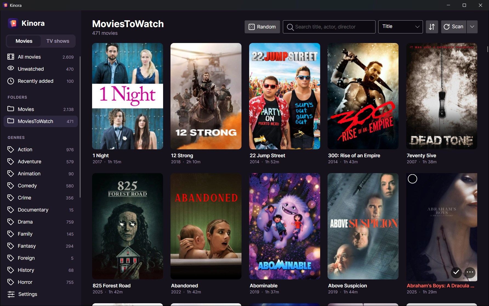
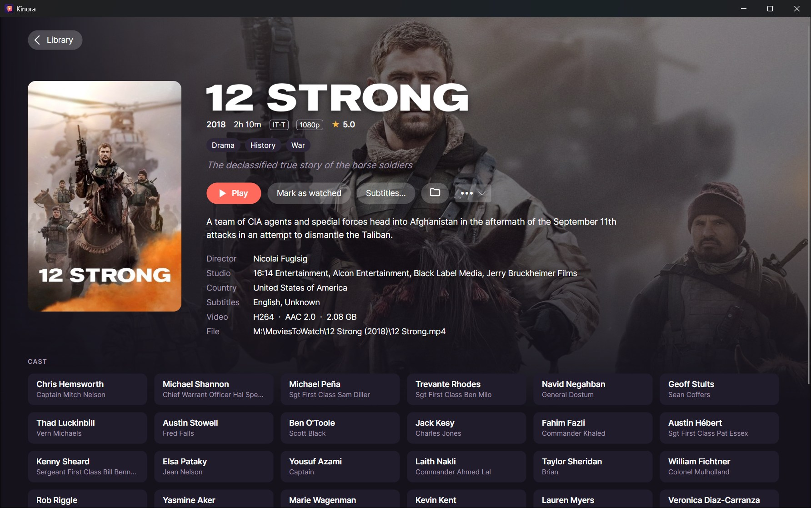
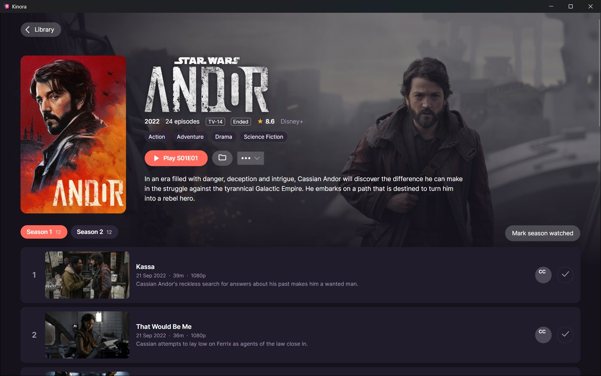
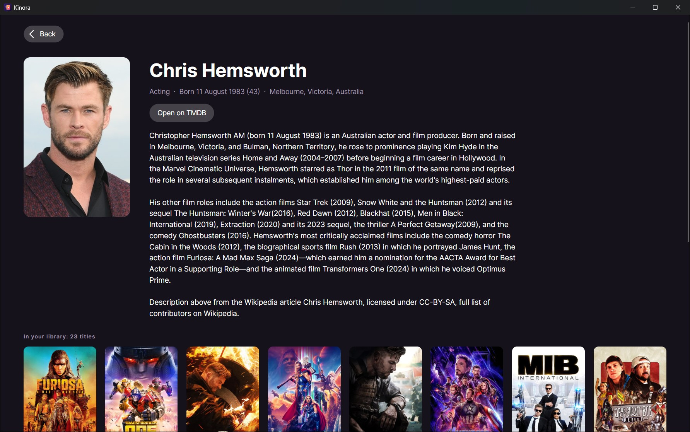
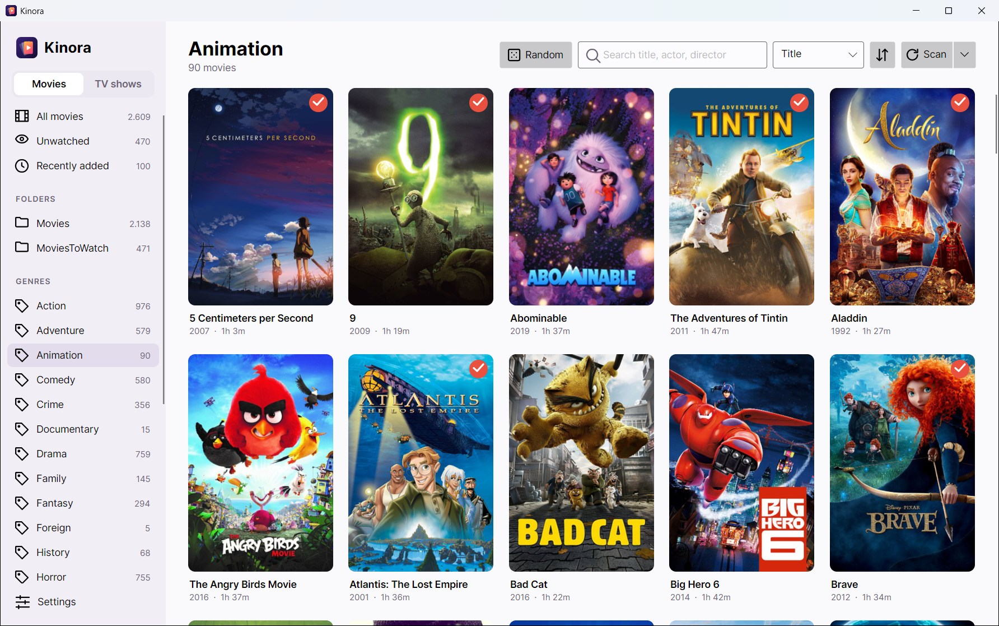

# Kinora

[](https://github.com/FirekeeperPhate/Kinora/releases/latest)
[](https://github.com/FirekeeperPhate/Kinora/releases)
[](LICENSE)

A desktop library for movies and TV shows kept in folders on a disk or a NAS.
Covers, metadata, light and dark theme; Play opens the video in Kinora's own player (VLC's
engine), or, if you prefer, in the player the OS associates with it. Windows, Linux and macOS
(Avalonia 12, .NET 10).

**[Download the latest release](https://github.com/FirekeeperPhate/Kinora/releases/latest)**



| | |
|---|---|
|  |  |
| A movie page: Play, watched, subtitles, the folder, Move to | A show: seasons, episodes, the next one to play |
|  |  |
| Click a name in the cast: biography and their titles in the library | Light theme |

<sub>Posters, pictures and texts in the screenshots come from TMDB and belong to their owners.</sub>

## What it does now

- **Library folders**: as many as you like. Each movie in its own folder, collection folders
  (`Alien Collection/Alien (1979)/…`), or loose files in the root.
- **Local metadata first**: Kodi / Emby / Jellyfin `.nfo` files (`movie.nfo` and `<video>.nfo`:
  the newer wins, the older fills the gaps), posters, fanart and clear logos with the usual names,
  subtitles next to the video. Without an nfo, title and year come from the folder or file name;
  `[imdbid-tt…]` and `{tmdb-…}` in names are read too.
- **Fast on a NAS**: the library opens from a local SQLite database and a local cache of resized
  posters, never touching the share. A scan enters only the folders whose time changed; a full
  scan reads them all. 472 movies on a NAS: first scan 8.5 s (posters included), the next 0.1 s.
- **Offline-safe**: a root that doesn't answer (NAS asleep or off) deletes nothing; its movies are
  marked offline.
- **Watched** flags survive rescans, and a movie moved outside Kinora keeps it (by IMDb/TMDB id).
- Search across title, original title, year, director, collection and cast; accents and
  punctuation don't matter. Sort by title (articles ignored), year, date added, rating.
- Folders that are mounted somewhere else later (another drive letter, another OS): change the
  root's path in Settings, nothing is scanned again. Paths are stored relative to the root.
- Names that Windows normally tidies up, ending with a dot or a space (`S.W.A.T.`), are read,
  moved and deleted as they are: a show `S.W.A.T.` next to a `S.W.A.T` keeps its own episodes.

## TV shows

- One folder per show, with `tvshow.nfo` and pictures (poster, fanart, clearlogo, `seasonNN-poster.jpg`);
  episodes in season folders (`Season 01`, `S2`, `Specials`…) or loose in the show folder.
- Episode numbers from the episode nfo or the name: `S01E02`, `S04E10-E11` (two in one file), `1x02`,
  `05 - Title` or `Episode 5` inside a season folder.
- A show is read again only when its folder or a season folder changed. 159 shows and 7,274
  episodes on a NAS: first scan about 20 s, the next 0.3 s.
- The show page lists seasons and episodes with their pictures (made on demand), marks episodes
  watched one by one or a season at a time, and plays the next one not seen. With TMDB, episodes
  missing from the folder are listed greyed out.
- Watched episodes are remembered by the show's ids and the episode number, so a better copy of
  an episode keeps the flag.

## Online metadata (TMDB)

With a TMDB API key (Settings), what the folders don't say comes from The Movie Database:

- movies without ids are searched by title and year, and taken only when the match is sure
  (same title, year within one); the rest wait in **Not identified**, where **Identify…** lets
  you choose;
- movies with gaps (no plot, genres, cast, poster or fanart) get them filled; what the folder
  says always wins, and a rescan keeps what came from TMDB (it is kept apart, in its own table,
  and merged again whenever a movie is rebuilt from its folder);
- missing posters are downloaded into Kinora's cache; backdrops and logos when a movie page opens;
- with **Save downloaded metadata and pictures in the movie folders** on (off by default) a
  `movie.nfo` and the missing pictures are written next to the movie; existing files are never
  replaced.

The key is stored encrypted for the Windows user (DPAPI); on Linux and macOS in a settings file
only the user can read.

## Playing

Play opens the video in Kinora's player, over the whole window: VLC's engine draws it (hardware
decoding, 4K and HDR included: a 4K HDR10 HEVC movie from the NAS takes 7% of one core), Kinora's
controls sit over it and go away after three seconds without moving the mouse.

- Play/pause, back 10 s, forward 30 s, the seek bar, volume and mute, full screen; the audio track
  and the subtitles (the ones in the file and the `.srt` files next to it) from two menus.
- Keys: Space or K play/pause, ← →  back 10 s / forward 30 s (Ctrl+→ a minute), ↑ ↓ volume, M mute,
  F or a double click full screen, A and S the next audio track or subtitle, Esc leaves full screen,
  then the player.
- It starts again where you stopped (past the first minute; "Start over" goes back to the
  beginning), and marks the movie or episode watched once 90% is behind or it reaches the end.
- Settings → Playback: Kinora's player, or the app the system opens videos with.

On Windows VLC's engine comes with Kinora (64-bit libvlc 3.0, about 20 MB more in the setup). On
macOS and Linux Kinora uses the VLC installed on the computer (`/Applications/VLC.app`, or the
`vlc` package); without it, Play opens the system's player and says why.

## Subtitles (OpenSubtitles)

With an OpenSubtitles API key and account (Settings), **Subtitles…** on a movie page, or **CC** on an
episode, searches by the file's OpenSubtitles hash (two 64 KB reads, even on the NAS) together with
the IMDb/TMDB ids; subtitles made for that exact file come first, then the preferred languages in
their order. The chosen one is saved next to the video as `<video>.<lang>.srt` (`.sdh`, `.forced`
when so); one already there with that name is kept as `.old`. Each download counts against the
account's daily quota, shown in the window. Key and password are stored like the TMDB key.

## Moving between library folders

**Move to** (right click on a poster, or the ••• menu of a page) moves a movie or a show to another
library folder of the same kind. On the same drive it is a rename. Otherwise everything is copied
into a hidden `.<name>.kinora-moving` folder next to the destination, every size is checked, the
folder is renamed into place, and only then is the original deleted; a cancel or an error before
that removes the partial copy and leaves the original as it was. A name already at the
destination stops the move before anything is touched. The library keeps the same entry (watched,
TMDB match). On Windows the copy uses CopyFileEx, which lets a server that supports it copy between
its own shares; a 1.8 GB movie between two shares of the NAS took 19 s at about 100 MB/s.

## Deleting

**Delete…** (right click on a poster, the ••• menu of a page, or the selection bar) deletes a movie
or a show from the disk and from the library; **Delete episode…** (right click on an episode) one
episode. First a question says what goes: the folder, how many files and how big. Enter answers
Cancel; only a click on Delete deletes. Files are deleted for good: network shares have no
Recycle Bin.

- A movie or a show in its own folder goes with the whole folder (subtitles, nfo, pictures,
  extras), videos first: a video that is playing stops the delete before anything else goes.
  A loose movie, or an episode, goes with the small files named like its video (`Heat.nfo`,
  `Heat.en.srt`, `Heat-poster.jpg`, all listed in the question), never with another video:
  deleting `S01E01.mkv` leaves `S01E01-E02.mkv` and its files alone.
- Never a library folder, never a folder with other titles or another library folder inside,
  never a title inside another library folder, never through a link (a junction inside a title
  folder goes as a link; what it points to is not touched). Names ending with a dot, like
  `S.W.A.T.`, are taken as they are.
- Videos in the folder that the library doesn't count as part of the title (a movie folder put
  inside another one, which a scan doesn't read) are named in the question.
- The library changes only for what really went: if the NAS drops out, nothing is removed from
  it; if a delete stops halfway, the title is read again from the disk.

## Installing

Every package has the .NET runtime inside: nothing else to install. `installer\build.ps1` makes
them all (tests first) and copies them to `Z:\Dropbox\Software\Kinora`.

- **Windows** (10 1809 or later, x64): `Kinora-Setup-<version>.exe`. Installs for the current user
  without admin rights, or for everyone. Not signed: SmartScreen may warn the first time. Updates
  install over the old version; Kinora's data in `%LOCALAPPDATA%\Kinora` is never touched, not
  even by the uninstaller.
- **Linux** (x64): `Kinora-<version>-linux-x64.tar.gz`. Unpack and run `./install.sh` (menu entry,
  `kinora` command, all in the home folder; `install.sh --uninstall` removes it), or run `./Kinora`
  from the folder. Needs X11 or XWayland; the built-in player needs the `vlc` package.
- **macOS** (12 or later): `Kinora-<version>-macos-arm64.zip` for Apple silicon, `-x64` for Intel.
  Unzip and drag `Kinora.app` to Applications. Not signed or notarized: the first time, right-click
  it → Open (or `xattr -cr /Applications/Kinora.app`). The built-in player needs VLC in
  Applications.

Only the Windows installer has been tried on a real machine; the Linux and macOS packages are built
from Windows and have not been run yet.

## Updates and releases

Kinora looks at the latest release of `FirekeeperPhate/Kinora` on GitHub once a day (Settings →
Updates: on by default, "Check now"). On Windows, installed with the setup, it downloads the new
setup, checks its size and SHA-256 against the release, runs it silently and closes; the setup
waits for it, updates and starts Kinora again. On Linux and macOS it opens the release page.

To publish a version: raise `<Version>` in `Directory.Build.props`, commit, write the notes, then
`installer/release.ps1 -Notes notes.md` (packages, `v<version>` tag, GitHub release with the
packages; their names are the ones the updater looks for).

## Building

```
dotnet build Kinora.slnx
dotnet test --project tests/Kinora.Tests
dotnet run --project src/Kinora
```

`bin` and `obj` go to `%LOCALAPPDATA%\KinoraBuild` (or `~/.cache/KinoraBuild`), not next to the
sources: the repository lives in a synced folder.

Kinora's data (database, settings, picture cache) is in `%LOCALAPPDATA%\Kinora`,
`~/.local/share/Kinora` or `~/Library/Application Support/Kinora`. Set `KINORA_DATA` to use
another folder, e.g. to try things without touching the real library.

The icon is drawn by `tools/IconMaker`:

```
dotnet run --project tools/IconMaker -- src/Kinora/Assets
```

## Layout

- `src/Kinora.Core`: models, scanning (nfo, names, artwork), SQLite, image cache, launcher. No UI.
- `src/Kinora`: the Avalonia app (MVVM with CommunityToolkit.Mvvm).
- `tests/Kinora.Tests`: xUnit v3 (Microsoft Testing Platform, see `global.json`).

## License

Kinora is released under the [MIT License](LICENSE). The software it uses, and ships in its
packages, is listed with its licenses in [THIRD-PARTY-NOTICES.txt](THIRD-PARTY-NOTICES.txt).

This product uses the TMDB API but is not endorsed or certified by TMDB. Subtitles come from
OpenSubtitles.com.
